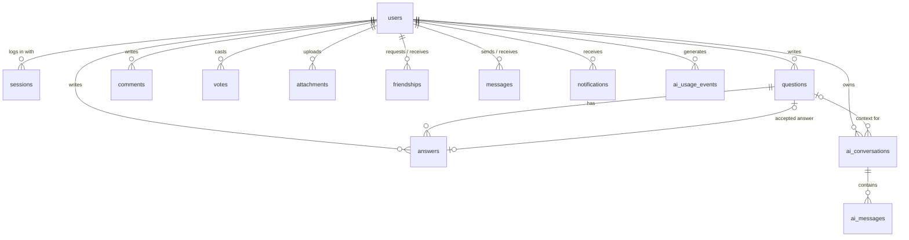

*This project has been created as part of the 42 curriculum by yaykhlf, mel-mouh, gstitou, fkoukou, iel-kher.*

# Knowly

## Description

**Knowly** is a community question-and-answer platform for students: ask a question, get answers from peers, vote on what helped, and accept the answer that solved the problem. Around that core it adds a social layer (profiles, friends, private messages, notifications) and an AI layer (a streaming assistant and automated content moderation).

The goal of the project is to build a complete, multi-user web application — frontend, backend and database — deployed with a single command, as the final project of the 42 Common Core (`ft_transcendence`).

### Key features

- **Q&A forum** — questions with Markdown bodies and tags, answers, comments, up/down votes, accepted answers, view counts, `@mentions`.
- **Accounts** — email + password sign-up and login, Google OAuth sign-in and account linking, profile editing, avatar upload, account deletion with anonymization.
- **Social** — friend requests, friends list with online status, one-to-one private messaging, user directory and user search.
- **Notifications** — an inbox and unread badge covering content creation, edits, deletions, votes, mentions, friend events and moderation decisions.
- **Search** — full-text search over questions with filters (tag, author, status, date range), sorting and pagination.
- **File attachments** — images, PDFs and text files attached to questions and answers, with validation, previews and access control.
- **AI assistant** — a chat interface to an LLM with token-by-token streaming, per-user rate limiting, and optional question context. Its replies are grounded in existing forum answers and cite them (RAG).
- **AI content moderation** — every post is screened automatically; flagged content is held in an admin review queue.
- **Design system** — color, type and icon tokens plus reusable components, documented on a live page (`/design-system`).
- **Privacy Policy and Terms of Service** pages, linked from the footer of every page.

## Instructions

### Prerequisites

| Tool | Version | Notes |
|---|---|---|
| Docker Engine | 24+ | with the Compose v2 plugin (`docker compose`) |
| GNU Make | any | |
| OpenSSL | any | generates the self-signed TLS certificate |
| Google Chrome | latest stable | reference browser |

Nothing else needs to be installed on the host: Python, Node.js and PostgreSQL all run inside containers.

### Run

```bash
git clone https://github.com/Yassir-aykhlf/Knowly.git
```

```bash
cd Knowly
```

```bash
make run
```

`make run` does everything needed on a fresh clone:

1. copies `.env.example` to `.env` if `.env` does not exist yet,
2. generates a self-signed certificate in `certs/` if there is none,
3. builds and starts the four services (`docker compose up -d --build`).

The backend waits for the database, applies the Alembic migrations, then starts. Once the containers are healthy, open:

**https://localhost:8443**

The certificate is self-signed, so Chrome shows a warning on the first visit; accept it to continue. Plain HTTP on port `8080` redirects to HTTPS.

### Configuration (`.env`)

`.env` is ignored by Git; `.env.example` is the committed template. The defaults are enough to run the core application locally. Review these before any real deployment or to enable the optional features:

| Variable | Purpose |
|---|---|
| `POSTGRES_USER`, `POSTGRES_PASSWORD`, `POSTGRES_DB`, `DATABASE_URL` | Database credentials. Keep `DATABASE_URL` consistent with the three others. |
| `SECRET_KEY` | Application secret. Generate one with `python -c "import secrets; print(secrets.token_urlsafe(48))"`. |
| `SESSION_LIFETIME_DAYS` | Lifetime of a login session (default 14). |
| `GOOGLE_OAUTH_CLIENT_ID`, `GOOGLE_OAUTH_CLIENT_SECRET`, `GOOGLE_OAUTH_REDIRECT_URI` | Enables "Continue with Google". The redirect URI must match the one registered in the Google Cloud console exactly, port included (locally: `https://localhost:8443/api/auth/google/callback`). |
| `LLM_API_KEY`, `LLM_MODEL`, `LLM_RATE_LIMIT_PER_HOUR` | OpenAI API key and model for the AI assistant and moderation. Without a key the assistant reports that it is unavailable and posts are published without AI screening. |
| `MODERATION_ENABLED`, `MODERATION_THRESHOLD`, `MODERATION_THRESHOLD_OVERRIDES` | Moderation switch, global score threshold (0–1), and optional per-category thresholds as a JSON object. |
| `INITIAL_ADMIN_EMAIL` | The account with this email is promoted to admin at startup. |
| `UPLOAD_MAX_BYTES`, `AVATAR_MAX_BYTES` | Size limits for attachments (5 MB) and avatars (2 MB). |

The backend refuses to start if a required variable is missing (`scripts/check-env.sh`).

### Useful commands

| Command | Effect |
|---|---|
| `make run` | Build and start everything |
| `make seed` | Fill the database with a repeatable demo dataset (users, questions, answers, votes, friendships, messages) |
| `make logs` | Follow the logs of all services |
| `make down` | Stop the stack (data volumes are kept) |

Interactive API documentation (OpenAPI) is served at `https://localhost:8443/api/docs`.

## Team Information

| Member | Role(s) | Responsibilities |
|---|---|---|
| **Yassir Aykhlf** (`yaykhlf`) | Tech Lead | Defined the architecture, the tech stack and the database schema. |
| **Mohamed El Mouhib** (`mel-mouh`) | Developer | Questions API and the main application UI (feed, ask/edit pages, layout and styling). |
| **Ghita** (`gstitou`) | Developer | Authentication and user management: sessions, registration, login, OAuth, profiles, avatars, online status, account deletion. |
| **Fatima Ezzahrae Koukou** (`fkoukou`) | Developer | Social features: notifications, friends, private messaging, user search. |
| **Ismail El kherrak** (`iel-kher`) | Developer | AI and tooling features: LLM client and assistant, content moderation, file uploads, search. |

## Project Management

- **Work split into four lanes.** The application was divided into four vertical feature areas so that members could work in parallel with few conflicts: **Lane A** — authentication and users, **Lane B** — Q&A content, **Lane C** — social features, **Lane D** — AI, moderation, files and search.
- **Test-driven Development.** Each task came with a specification and a test file (`backend/tests/lane_*/`); a task was done when its tests passed. Cross-lane integration was checked by milestone tests (`backend/tests/milestones/`).
- **GitHub flow.** `main` is protected. All work lands through pull requests from `<type>/<description>` branches, reviewed by at least one teammate, with Conventional-Commits messages. The rules are written down in [`CONTRIBUTING.md`](CONTRIBUTING.md).
- **Tools.** GitHub (repository, pull requests, code review).

## Technical Stack

### Frontend

- **React 18** with **TypeScript**, built with **Vite**
- **React Router 6** for client-side routing
- **Tailwind CSS** with a custom theme (color tokens, type scale, radii) in `frontend/tailwind.config.js`
- **react-markdown** + **rehype-sanitize** to render user-written Markdown safely

### Backend

- **Python 3.11**, **FastAPI**, served by **Uvicorn**
- **SQLAlchemy 2.0** (async, `asyncpg` driver) as ORM, **Alembic** for migrations
- **Pydantic v2** for request/response validation and settings
- **passlib / bcrypt** for password hashing
- **httpx** for outbound calls (Google OAuth, OpenAI)
- **Pillow** and **python-magic** to validate uploaded files by content
- **pytest** + **pytest-asyncio** for tests

### Database

**PostgreSQL 15.** A Q&A platform is relational by nature — users, questions, answers, comments and votes all reference each other — so a relational database with real foreign keys and constraints was the natural choice.

### Infrastructure

- **Docker Compose** with four services: `db` (PostgreSQL), `backend` (FastAPI), `frontend` (builds the static bundle), `nginx`
- **Nginx** terminates TLS, serves the frontend bundle and avatars, and reverse-proxies `/api/` to the backend. Only Nginx is published on the host; the backend and database are reachable only on the internal Docker network.

### Justification of the main choices

- **FastAPI** — async from top to bottom, which suits long-lived streaming responses from the LLM; validation and OpenAPI documentation come directly from the type annotations.
- **SQLAlchemy + Alembic** — no raw SQL in application code, and every schema change is a versioned migration applied automatically at startup.
- **React + TypeScript** — component model for a UI with many repeated elements (question cards, vote arrows, avatars); types shared across pages catch API-shape mistakes at build time.
- **Tailwind CSS** — consistent design tokens without maintaining separate stylesheets; responsive variants make mobile layouts straightforward.
- **Server-side sessions instead of JWT** — the browser holds an opaque random token in an `HttpOnly`, `Secure`, `SameSite=Lax` cookie; the database stores only its SHA-256 hash. Sessions can be revoked instantly (logout, password change, account deletion) and JavaScript never sees the token.
- **Polling instead of WebSockets** — messages, notifications and online status are refreshed by periodic requests that pause while the tab is hidden.

## Database Schema

Thirteen tables. All primary keys are UUIDs; all tables carry a `created_at` timestamp.



`comments`, `votes` and `attachments` point at either a question or an answer through a `(parent_type / target_type, id)` pair, and `notifications` point at their subject the same way.

| Table | Key fields | Notes |
|---|---|---|
| `users` | `email` varchar(254) unique, `username` varchar(30) unique, `password_hash` text, `avatar_path` text, `bio` text ≤ 500, `role` (`user` \| `admin`), `oauth_provider` + `oauth_subject` (unique pair), `is_anonymized` bool, `last_seen` timestamp | `email` and `password_hash` are nullable for OAuth-only and anonymized accounts. |
| `sessions` | `user_id` → users, `token_hash` text unique, `expires_at` timestamp | Stores the SHA-256 hash of the session token, never the token. |
| `questions` | `author_id` → users, `title` varchar(200), `body` text, `tags` text[] (≤ 5), `accepted_answer_id` → answers, `view_count` int, `moderation_status`, `moderation_note`, `search_vector` tsvector | GIN indexes on `search_vector` and `tags`. |
| `answers` | `question_id` → questions, `author_id` → users, `body` text, `is_ai_assisted` bool, `moderation_status`, `moderation_note` | Deleted with their question. |
| `comments` | `author_id` → users, `parent_type` (`question` \| `answer`), `parent_id` uuid, `body` text ≤ 1000, `moderation_status` | |
| `votes` | `voter_id` → users, `target_type`, `target_id` uuid, `value` smallint (−1 \| 1) | Unique per `(voter, target)`: one vote per user per post. |
| `attachments` | `uploader_id` → users, `parent_type`, `parent_id` (nullable), `original_filename`, `stored_path`, `mime_type`, `size_bytes` int | `parent_id` is null until the post it belongs to is submitted. |
| `friendships` | `requester_id` → users, `addressee_id` → users, `status` (`pending` \| `accepted` \| `rejected`) | Unique index on the unordered pair: at most one row between two users. |
| `messages` | `sender_id` → users, `receiver_id` → users, `body` text ≤ 4000, `read_at` timestamp | |
| `notifications` | `recipient_id` → users, `actor_id` → users, `event_type` varchar(48), `subject_type`, `subject_id`, `link` text, `coalesce_key` text, `actor_count` int, `read_at` timestamp | Similar unread events are merged into one row ("3 people voted on your answer"). |
| `ai_conversations` | `user_id` → users, `question_id` → questions (nullable), `title` text | |
| `ai_messages` | `conversation_id` → ai_conversations, `role` (`user` \| `assistant`), `content` text | |
| `ai_usage_events` | `user_id` → users, `created_at` | One row per assistant request; used for the hourly rate limit. |

`moderation_status` is one of `pending`, `approved`, `rejected` everywhere it appears. Length limits and enumerations are enforced by `CHECK` constraints in the database as well as by the API.

## Features List

| Feature | Description | Member(s) |
|---|---|---|
| Project skeleton and deployment | Docker Compose stack, Nginx with HTTPS, environment check, automatic migrations, `make run` | yaykhlf |
| Database schema and migrations | SQLAlchemy models, constraints, indexes, Alembic migrations | yaykhlf |
| Uniform error handling | Every API error uses one JSON shape (`code`, `message`, per-field errors) | yaykhlf |
| Registration, login, logout | Email + password, hashed passwords, server-side sessions in a secure cookie | gstitou |
| Google OAuth | Sign in with Google; link a Google account to an existing account | gstitou |
| Profile | Public profile page with a user's questions and answers; edit username, bio, password | gstitou |
| Avatars | Upload, replace, delete; a default avatar is shown otherwise | gstitou |
| Online status | Heartbeat from the browser; friends see who is online | gstitou |
| Account deletion | Deletes the account and anonymizes the content it leaves behind | gstitou |
| Questions | Create, read, edit, delete; feed with sorting and pagination; tags; view counts | Mohamed |
| Accepted answer | The question author can mark one answer as accepted | Mohamed |
| Home, Ask and Edit pages, app layout | Question feed, question cards, question form, overall styling | Mohamed |
| User directory | Page listing all users | Mohamed |
| Answers, comments, voting | Full create/edit/delete for answers and comments; up/down voting on questions and answers | Mohamed |
| Question detail page | Markdown rendering, answers, comments, vote controls, moderation banner | Mohamed |
| Visibility rules | A single place deciding who may see pending or rejected content (author and admins only) | yaykhlf |
| Notifications | Inbox page, unread badge, mark one / mark all as read, merging of similar events | fkoukou |
| Friends | Send, accept, reject, remove; friends list and pending requests | fkoukou |
| Private messages | Conversation list, one-to-one chat, unread tracking | fkoukou |
| User search | Search bar to find other users | fkoukou |
| LLM client and AI assistant | Streaming chat with an LLM, conversation history, error handling | iel-kher |
| Assistant rate limiting | Per-user hourly limit, stored in the database | yaykhlf |
| Retrieval-augmented answers (RAG) | The assistant searches existing forum answers for each message, gives the best ones to the LLM, and lists the cited sources under the reply | yaykhlf |
| Content moderation | Automatic screening of every post, admin review queue with approve / reject | iel-kher |
| Admin bootstrap | First admin from configuration, plus a CLI command to promote users | iel-kher |
| File attachments | Upload API and UI, validation, previews, download, delete | iel-kher |
| Search | Full-text search API and page with filters, sorting, pagination | iel-kher |
| Design system | Color palette, type scale, icon set and reusable components, with a live reference page at `/design-system` | yaykhlf |
| Landing page, Privacy Policy, Terms of Service | Public pages and footer links | yaykhlf |
| Demo data | Repeatable seed tool generating a realistic dataset | yaykhlf |
| Automated tests | Backend test suite organized per lane and per milestone | yaykhlf |

## Modules

Major = 2 points, Minor = 1 point. **Total claimed: 17 points.**

| # | Category | Module | Type | Points |
|---|---|---|---|---|
| 1 | Web | Use a framework for both the frontend and backend | Major | 2 |
| 2 | Web | Allow users to interact with other users | Major | 2 |
| 3 | Web | Use an ORM for the database | Minor | 1 |
| 4 | Web | Complete notification system | Minor | 1 |
| 5 | Web | Advanced search with filters, sorting and pagination | Minor | 1 |
| 6 | Web | File upload and management system | Minor | 1 |
| 7 | User Management | Standard user management and authentication | Major | 2 |
| 8 | User Management | Remote authentication with OAuth 2.0 | Minor | 1 |
| 9 | Artificial Intelligence | Complete LLM system interface | Major | 2 |
| 10 | Artificial Intelligence | Content moderation AI | Minor | 1 |
| 11 | Artificial Intelligence | Complete RAG system | Major | 2 |
| 12 | Web | Custom-made design system | Minor | 1 |
| | | | **Total** | **17** |

### 1. Frameworks for frontend and backend — Major (2)

- **Why:** a project of this size needs structure, routing and validation out of the box on both sides.
- **How:** React 18 (with React Router) for the frontend; FastAPI for the backend, organized in routers, services, schemas and models.
- **Who:** Yassir (scaffolding).

### 2. User interaction — Major (2)

- **Why:** a Q&A community only works if members can find and talk to each other, not just to posts.
- **How:**
  - *Chat* — one-to-one private messages (`/api/messages`), conversation list with unread counts, a conversation page that fetches new messages every few seconds.
  - *Profiles* — a public profile page for every user with their information, questions and answers.
  - *Friends* — send, accept, reject and remove; friends list with online status; pending requests. A database index guarantees a single friendship record per pair of users.
- **Who:** Fatima Ezzahrae (chat, friends), Ghita (profiles).

### 3. ORM — Minor (1)

- **Why:** safer and more maintainable than hand-written SQL; queries are built from typed models and parameters are always bound, which rules out SQL injection.
- **How:** SQLAlchemy 2.0 in async mode for every database access, with Alembic migrations applied at startup. There is no raw SQL in the application code.
- **Who:** Yassir (models, migrations).

### 4. Notification system — Minor (1)

- **Why:** users need to know when something happens to their content without checking every page.
- **How:** notifications are created in the same database transaction as the action that causes them, for creation (new answer, new comment, mention, friend request), update (content edited, vote cast, friend request accepted, moderation approved / rejected / pending) and deletion (content deleted, friend removed). The frontend shows an unread badge that refreshes periodically and an inbox page with mark-as-read and mark-all-as-read. Similar unread events are merged into a single notification with a counter.
- **Who:** Fatima Ezzahrae (inbox API and UI, friend events), Ismail El kherrak (moderation events).

### 5. Advanced search — Minor (1)

- **Why:** the first thing to do before asking a question is to check whether it was already answered.
- **How:** `GET /api/search` uses PostgreSQL full-text search on a GIN-indexed `tsvector`. **Filters:** tags, author, status (unanswered / answered / accepted), date range. **Sorting:** relevance, newest, votes, number of answers. **Pagination:** `page` and `limit`. Results include highlighted excerpts. The search page exposes all of these controls.
- **Who:** Ismail El kherrak.

### 6. File upload and management — Minor (1)

- **Why:** screenshots, logs and PDFs are often the fastest way to explain a problem.
- **How:**
  - *Multiple file types:* PNG, JPEG, WebP, GIF, PDF, plain text, Markdown.
  - *Validation:* the server ignores the declared type and inspects the actual bytes (magic numbers, image decoding with Pillow, UTF-8 check for text) and enforces the size limit. The browser checks type, extension and size (5 MB) before sending anything, limits the number of attachments per post (10), and displays the server's validation errors.
  - *Secure storage and access control:* files are stored under random names outside the web root and served only through the API, which applies the same visibility rules as the post they belong to. Only the uploader can attach or delete them.
  - *Previews* for images, a per-file *progress bar* with the percentage sent, and *deletion*.
- **Who:** Ismail El kherrak (API and UI).

### 7. Standard user management — Major (2)

- **Why:** the base every other feature depends on.
- **How:** users can update their profile information (username, bio, password); upload an avatar, with a default avatar when none is set; add other users as friends and see their online status (based on a browser heartbeat); and have a profile page displaying their information.
- **Who:** Ghita (accounts, profile, avatars, online status), Fatima Ezzahrae (friends).

### 8. OAuth 2.0 — Minor (1)

- **Why:** lets users sign in without creating yet another password.
- **How:** Google OAuth 2.0 authorization-code flow implemented on the backend, with a `state` value checked on return to prevent CSRF. A first sign-in creates an account; an existing account can be linked to Google from a confirmation page.
- **Who:** Ghita.

### 9. LLM system interface — Major (2)

- **Why:** an assistant that can explain a question or help draft one complements human answers, which can take hours to arrive.
- **How:**
  - *Text generation from user input:* users hold conversations with an LLM (OpenAI chat-completions API), optionally started from a question so the model receives its title and body as context. Conversations and messages are persisted.
  - *Streaming:* the backend relays the provider's token stream to the browser as server-sent events; Nginx buffering is disabled on that route. If the user leaves mid-answer, the partial reply is still saved.
  - *Error handling:* provider timeouts, provider rate limits, invalid streams and missing configuration are each mapped to a clear message shown in the chat; nothing fails silently.
  - *Rate limiting:* a per-user hourly quota stored in the database, enforced under a row lock so parallel requests cannot bypass it; the API answers `429` with a `Retry-After` header.
- **Who:** Ismail El kherrak (client, streaming endpoint, pages).

### 10. Content moderation AI — Minor (1)

- **Why:** a student community needs protection from abusive content without requiring an admin to read every post.
- **How:** every question, answer and comment — on creation and on edit — is scored by a moderation model. If a category score exceeds its configurable threshold, the post is set to *pending*, hidden from everyone except its author and admins, and the author is notified with the reason (**auto-moderation and auto-warning**). Admins review held posts in a moderation queue and approve or reject them; the author is notified of the decision. Verdicts are cached by content hash. If the moderation provider is unreachable, posts are published rather than blocked.
- **Who:** Ismail El kherrak.

### 11. RAG system — Major (2)

- **Why:** the forum already holds answers written and voted on by students. An assistant that ignores them repeats work and can contradict the community; one that reads them first gives answers users can verify.
- **How** (`backend/app/services/rag.py`):
  - *Dataset:* every approved, human-written answer on the forum, together with its question title and tags. It grows as the community posts. Pending, rejected and AI-assisted answers are excluded.
  - *Retrieval:* for each message, PostgreSQL full-text search ranks the answers against the user's words (plus the question title when the chat was opened from a question). Ties go to the accepted answer, then to votes. The top three are kept; for long answers only the most relevant excerpt is used.
  - *Generation:* the excerpts are added to the system prompt as numbered sources `[S1]`–`[S3]`, and the LLM is told to cite the ones it uses and to say so when none of them helps.
  - *Answer with sources:* when the reply is complete, the sources it actually cited are appended as links to the original answers, streamed to the browser and saved with the message.
- **Who:** Yassir.

### 12. Custom-made design system — Minor (1)

- **Why:** with five people writing pages, the interface only stays consistent if everyone builds from the same named colors, sizes and components instead of picking values per page.
- **How:** no component library is used; everything is built on Tailwind utilities.
  - *Color palette:* named tokens in `frontend/tailwind.config.js`, grouped by role — ink (text), surfaces and lines, accent (brand and actions), AI (assistant features), and status (warning, danger, online). Components use the token names, not hex values.
  - *Typography:* three families (Bricolage Grotesque for headings, Inter for text, JetBrains Mono for code and tags) and a named type scale from `2xs` to `display`.
  - *Icons:* one set of 21 stroke icons on a 24px grid, all rendered through a single `NavIcon` component so size and stroke stay uniform.
  - *Reusable components (more than 10):* `Avatar`, `Modal`, `Pager`, `BackButton`, `PostMeta`, `ModerationBanner`, `EmptyState`, `ErrorState`, `SkeletonCards`, `SkeletonRows`, `MarkdownBody`, `NavIcon`, `StatusPage` and the toast (`useToast`) in `frontend/src/components/`, plus the class-based components in `frontend/src/index.css`: buttons, form fields, tags, pills, badges, segmented control, alerts.
  - *Reference page:* `/design-system` (linked from the footer) renders the palette, the type scale, every icon and each component live, using the same code as the application.
- **Who:** Yassir.

### Not claimed

- **Real-time features (Web, Major)** — not claimed; the application uses polling, not WebSockets.
- **GDPR compliance (Data, Minor)** — not claimed; account deletion with anonymization is implemented, but data export and confirmation emails are not.

## Individual Contributions

### Yassir Aykhlf

- Initialized the repository and the full project skeleton: backend structure, frontend setup (React, Vite, TypeScript, Tailwind), Docker Compose, Nginx with TLS, Makefile.
- Designed the database schema and wrote the models and initial migrations.
- Wrote the global error handlers, the per-task specifications and the backend test suite.
- Wrote the landing page, the Privacy Policy and the Terms of Service.
- Added the demo-data seed tool, and the RAG feature of the assistant.

### Mohamed El Mouhib

- Implemented the questions API: create, list with sorting and pagination, detail, update, delete, accept an answer, with server-side validation of title, body and tags.
- Built the home feed, the question card, the ask / edit page and the users page.
- Reworked the application layout and overall styling.
- Fixed several display issues (zero-vote questions, reading other users' questions, comment serialization).

### Ghita

- Implemented sessions, registration, login and logout, and password change.
- Implemented public profiles, profile listings and profile editing.
- Implemented avatars and the online-status heartbeat.
- Implemented account deletion with anonymization.
- Implemented Google OAuth sign-in and account linking.
- Built the login, register, profile and settings pages.

### Fatima Ezzahrae Koukou

- Implemented the notifications inbox (API and page) and the unread badge.
- Implemented friend requests, responses, removal and listings, and the friends page.
- Implemented the private-messaging API and the messages and conversation pages.
- Implemented user search.

### Ismail El kherrak

- Implemented the LLM provider client, the AI conversation API, the streaming endpoint and the assistant pages.
- Implemented the moderation service, the moderation queue API and the admin moderation page.
- Implemented admin bootstrap and the `promote-admin` command.
- Implemented the files API and upload UI.
- Implemented the search API and the search page.

## Known Limitations

- Messages, notifications and online status are refreshed by polling, so updates appear after a short delay (about 5 seconds in an open conversation, up to 30 seconds elsewhere).
- The TLS certificate is self-signed; browsers warn on first visit.
- The AI assistant and AI moderation require an OpenAI API key. OpenAI is the only provider implemented.
- Google sign-in requires OAuth credentials from the Google Cloud console.

## Resources

### Documentation and references

- [FastAPI documentation](https://fastapi.tiangolo.com/)
- [SQLAlchemy 2.0 documentation](https://docs.sqlalchemy.org/en/20/) and [Alembic documentation](https://alembic.sqlalchemy.org/)
- [Pydantic documentation](https://docs.pydantic.dev/)
- [PostgreSQL — Full Text Search](https://www.postgresql.org/docs/15/textsearch.html)
- [React documentation](https://react.dev/) and [React Router documentation](https://reactrouter.com/)
- [Tailwind CSS documentation](https://tailwindcss.com/docs)
- [Vite documentation](https://vite.dev/)
- [Docker Compose documentation](https://docs.docker.com/compose/)
- [Nginx documentation](https://nginx.org/en/docs/)
- [OAuth 2.0 for Web Server Applications (Google)](https://developers.google.com/identity/protocols/oauth2/web-server)
- [OWASP Password Storage Cheat Sheet](https://cheatsheetseries.owasp.org/cheatsheets/Password_Storage_Cheat_Sheet.html) and [Session Management Cheat Sheet](https://cheatsheetseries.owasp.org/cheatsheets/Session_Management_Cheat_Sheet.html)
- [MDN — Using server-sent events](https://developer.mozilla.org/en-US/docs/Web/API/Server-sent_events/Using_server-sent_events)
- [OpenAI API reference](https://platform.openai.com/docs/api-reference)
- [Conventional Commits](https://www.conventionalcommits.org/)

### Use of AI

- This README was drafted with an AI assistant from the source code and Git history, then reviewed by the team.

## License

Released under the MIT License — see [`LICENSE`](LICENSE).
